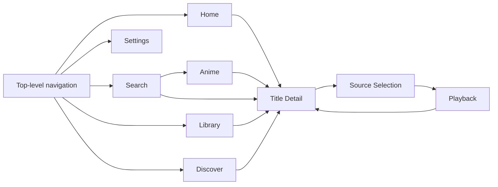

# Omnia Product and Apple UI Design Guide

This is the canonical product, flow, screen, and UI-element specification for Omnia. It describes both the repository snapshot and the direction for later work; it does not claim that every specified behavior ships today. Last reviewed: 2026-08-11.

## Status Language

- **Current** means the behavior or named type is verified in this repository snapshot.
- **Requirement** means a binding product, design, accessibility, or acceptance rule. It may describe behavior that is not implemented yet and is not proof of current support.
- **Intended** means a planned direction that is not yet a binding acceptance rule or is deliberately deferred. Intended concepts are written in plain language rather than presented as repository symbols.
- **Current gap** means verified behavior differs from a Requirement or lacks a required state.
- Unlabeled prose provides context only; it never implies implementation status. Use an explicit **Current** label for source-verified behavior and a **Requirement**, **Intended**, or **Current gap** label whenever status affects a decision.

## Product Definition and Principles

**Current.** Omnia is a native media discovery, local-library, source-selection, and playback hub for iPhone, iPad, and Mac. A person can browse or search, inspect a title, save it, select an episode or source, and play an approved direct HTTPS source. The review-gated macOS Release path can also materialize a validated torrent file locally after explicit peer consent; Omnia does not host media or trust add-on data automatically.

**Requirement.** Design decisions follow these priorities:

1. **Content first.** Artwork and editorial hierarchy lead; controls remain recognizable and readable.
2. **Apple native.** Prefer system navigation, controls, materials, text styles, symbols, and accessibility behavior.
3. **Cinematic, not ornamental.** Imagery, depth, and motion communicate identity or state without obscuring content.
4. **Transparent choices.** Show provider, add-on, resolver, and source limitations where they affect a decision.
5. **Useful without an account.** Discovery, local library state, and local configuration do not depend on sign-in.
6. **Resilient by section.** One unavailable provider, image, add-on, or shelf must not erase successful content elsewhere.

## Apple Reference Policy

**Requirement.** Apple guidance defines platform behavior, accessibility, and the vocabulary of system UI; it is not a pixel template. Use the current Apple kit that matches the deployment SDK to inspect component anatomy, states, safe areas, and platform scale. Re-create UI with system APIs and semantic values. Do not ship kit artwork, redistribute Apple resources, hard-code screenshots, or assume that a measurement from one platform transfers unchanged to another. Review the license supplied with each resource before using it outside product design work.

**Requirement.** The Apple TV experience is a reference for cinematic hierarchy, viewing-distance legibility, focus clarity, shelves, detail composition, and unobtrusive playback. It is not a pixel-copy target and is not evidence that Omnia supports tvOS. **Current:** the Xcode project targets iOS/iPadOS and macOS. **Intended:** any tvOS work requires its own target, focus model, remote interaction, assets, playback validation, and tests.

### Official Apple Resource Index

- UI kits: [iOS and iPadOS](https://developer.apple.com/design/resources/#ios-and-ipados), [macOS](https://developer.apple.com/design/resources/#macos), and [tvOS](https://developer.apple.com/design/resources/#tvos) on Apple Design Resources.
- Platform adaptation: [Designing for iOS](https://developer.apple.com/design/human-interface-guidelines/designing-for-ios/), [Designing for iPadOS](https://developer.apple.com/design/human-interface-guidelines/designing-for-ipados/), [Designing for macOS](https://developer.apple.com/design/human-interface-guidelines/designing-for-macos/), and [Designing for tvOS](https://developer.apple.com/design/human-interface-guidelines/designing-for-tvos/).
- Structure and interaction: [Navigation and search](https://developer.apple.com/design/human-interface-guidelines/navigation-and-search/), [Tab bars](https://developer.apple.com/design/human-interface-guidelines/tab-bars/), [Sidebars](https://developer.apple.com/design/human-interface-guidelines/sidebars/), [Search fields](https://developer.apple.com/design/human-interface-guidelines/search-fields/), and [Focus and selection](https://developer.apple.com/design/human-interface-guidelines/focus-and-selection/).
- Feedback and presentation: [Loading](https://developer.apple.com/design/human-interface-guidelines/loading/), [Progress indicators](https://developer.apple.com/design/human-interface-guidelines/progress-indicators/), [Materials](https://developer.apple.com/design/human-interface-guidelines/materials/), [Layout](https://developer.apple.com/design/human-interface-guidelines/layout/), and [Motion](https://developer.apple.com/design/human-interface-guidelines/motion/).
- Media and inclusion: [Playing video](https://developer.apple.com/design/human-interface-guidelines/playing-video/) and [Accessibility](https://developer.apple.com/design/human-interface-guidelines/accessibility/).
- Visual language: [SF Symbols](https://developer.apple.com/design/human-interface-guidelines/sf-symbols/), [Typography](https://developer.apple.com/design/human-interface-guidelines/typography/), and [Apple platform fonts](https://developer.apple.com/fonts/).

## Information Architecture and Primary Flow

**Current.** `OmniaRootView` uses a sidebar-adaptable tab view. Home, Search, Library, Discover, and Settings each own a navigation stack. Anime is a Search browse destination rather than a peer tab. The iOS family presents playback full screen; macOS overlays playback across the window and hides browsing toolbar chrome.

**Current:** top-level destinations remain present when their content is empty. Pushed browse/detail pages use system back behavior; transient sheets expose Cancel or Done; playback exposes Close while its chrome is visible; external handoff requires explicit source selection. **Requirement:** destructive settings actions require confirmation before applying an immediate, difficult-to-reverse change.

## Screen Contracts

Each contract maps a verified SwiftUI screen where one exists. Purpose statements are Requirements; interaction and state claims carry explicit Current, Requirement, Intended, or Current gap labels.

### Home — `HomeView`

- **Purpose:** **Requirement:** personalized editorial start: featured content, Continue Watching, ranked titles, genres, and built-in catalog shelves.
- **Entry and exit:** **Current:** opens from the Home tab. A hero, poster, ranked poster, shelf heading, or resume card pushes a detail or catalog page; the tab bar/sidebar moves to peer areas.
- **Primary action:** **Current:** open featured-title details. Saving to My List is secondary; a Continue Watching card enters the title flow.
- **Loading, empty, error:** **Current:** a branded hero loader appears before a feature resolves; catalog loading has a labeled progress view; total built-in discovery failure has a contextual unavailable view. Continue Watching is omitted when empty. **Intended:** retain any successful shelf and offer a retry for failed sections.
- **Platform interaction:** **Current:** edge-to-edge hero and gesture-first shelves; macOS reveals shelf controls on hover and uses a transparent unified toolbar. iPhone and iPad remain touch-first. Hero paging also has explicit previous/next controls.
- **Accessibility:** **Current:** the feature, paging dots, controls, cards, and progress expose labels or values; backdrop decoration is hidden. **Current gap:** the unconditional nine-second carousel timer does not observe VoiceOver focus, Reduce Motion, or an interaction-active state. **Requirement:** pause automatic advance while a person interacts with or reads the hero, disable it under Reduce Motion, preserve focus, and keep manual paging available.

### Anime — `AnimeDiscoveryView`

- **Purpose:** **Requirement:** anime-specific browse and search using the configured metadata route.
- **Entry and exit:** **Current:** opens from the Anime category on Search. Shelf headings and genres push paged catalogs; posters push detail; system back returns through the stack.
- **Primary action:** **Current:** open an anime title. The source menu explains the active primary and fallback providers without becoming a competing browsing control.
- **Loading, empty, error:** **Current:** browse and pagination show progress; unavailable discovery and exhausted empty catalogs use explicit unavailable views; search begins at two characters and distinguishes searching from no results. **Intended:** show provider-specific failure and retry without removing cached shelves.
- **Platform interaction:** **Current:** search uses the system search field; shelves become adaptive poster grids on pushed catalog pages; shared native controls provide platform pointer and keyboard behavior.
- **Accessibility:** **Current:** source state uses text with symbols, shelf labels describe their collections, and poster links expose titles. **Requirement:** announce search-result updates without moving focus. **Current gap:** no explicit result-update announcement is implemented.

### Search — `SearchView`

- **Purpose:** **Requirement:** find titles across built-in metadata and searchable enabled add-on catalogs.
- **Entry and exit:** **Current:** opens from Search; its empty state presents genre cards including Anime, selecting a genre or result pushes its destination, and clearing the query returns to the genre directory.
- **Primary action:** **Current:** enter a query and open a matching title. Library titles appear as system search suggestions.
- **Loading, empty, error:** **Current:** a query shorter than two characters shows the genre directory; a 250 ms debounce precedes concurrent built-in/add-on search; searching and no-result states are explicit. **Current gap:** provider failure can be indistinguishable from no results. **Intended:** preserve partial results and distinguish no match, offline, and provider failure with retry.
- **Platform interaction:** **Current:** system search presentation, adaptive grids, and native back navigation are used. **Requirement:** preserve platform keyboard submission/clearing behavior and do not replace the search field with hero chrome.
- **Accessibility:** **Current:** results are title-labeled links in grid order. **Requirement:** communicate search scope, partial-source status, and updated result count through concise announcements. **Current gap:** these explicit announcements are not implemented.

### Library — `LibraryView`

- **Purpose:** **Requirement:** present the locally saved collection and playback progress.
- **Entry and exit:** **Current:** opens from Library; a poster pushes detail; a toolbar menu changes kind filter and sort; system back returns from detail.
- **Primary action:** **Current:** open a saved title to resume, play, or manage it.
- **Loading, empty, error:** **Current:** local data is available synchronously, so no loading state is shown; an empty filtered result uses the same “Your Library Is Empty” message as a truly empty library. **Intended:** distinguish no saved titles from no filter matches, provide Clear Filter, and show sync state only when cloud sync is connected.
- **Platform interaction:** **Current:** iPhone/iPad use a two-column grid; macOS uses an adaptive grid. Filter and sort remain a platform menu rather than custom chips.
- **Accessibility:** **Current:** poster links expose titles and filter/sort controls keep text labels. **Requirement:** progress is available as an accessibility value wherever visible, not conveyed by a bar alone. **Current gap:** the generic poster link does not add a spoken progress value.

### Discover — `DiscoverView`

- **Purpose:** **Requirement:** explore ranked, genre, built-in, saved, and individually enabled add-on catalogs beyond Home’s editorial subset.
- **Entry and exit:** **Current:** opens from Discover; shelf headings push full catalogs, posters push detail, and the Catalogs toolbar action pushes catalog settings.
- **Primary action:** **Current:** open a title; configuring catalog visibility is secondary.
- **Loading, empty, error:** **Current:** built-in loading and total failure are explicit. Add-on shelves load independently; an empty or failed add-on shelf disappears while other content remains. **Intended:** expose a compact per-shelf unavailable/retry state when hiding it would confuse the person.
- **Platform interaction:** **Current:** vertical content contains horizontal shelves; genre rows and full adaptive grids use system navigation; the shared shelf supports native scrolling plus macOS hover controls.
- **Accessibility:** **Current:** every shelf has a collection label; actionable headings have explicit “Open” labels; poster items expose titles. **Requirement:** status never depends only on artwork or provider marks.

### Detail — `MediaDetailView`

- **Purpose:** **Requirement:** turn a lightweight result into a complete title identity and the decision point for save, play/resume, season/episode, synopsis, people, video, collection, and recommendation actions.
- **Entry and exit:** **Current:** pushed from any media card. iOS shows an explicit overlay Back control; macOS uses native navigation chrome. Synopsis and source selection are sheets; related titles push another detail page.
- **Primary action:** **Current:** Play, Resume, or Rewatch; for a series, selecting an episode opens source selection. One circular watched-state action matches the existing circular Add/remove My List action in the hero identity column: `eye` means Mark as Watched and `eye.slash` means Mark as Unwatched.
- **Loading, empty, error:** **Current:** the selected lightweight item renders immediately while provider, add-on, and optional rating data resolve; missing sections are omitted and missing backdrop leaves the semantic page background visible. MDBList ratings have compact nonblocking loading, authentication/settings, rate-limit, transient Retry, valid-empty, and cancellation states; stale title results are rejected. **Current gap:** non-rating enrichment failure has no visible error or retry. **Intended:** retain the base detail, show section-level failure only where useful, and never replace the whole page with a spinner.
- **Platform interaction:** **Current:** artwork meets the top edge; iOS hides the navigation bar, while macOS keeps the transparent window toolbar. Long synopsis opens a sheet. External trailer selection opens YouTube explicitly.
- **Accessibility:** **Current:** Back, synopsis, available title logo, metadata, rating values, episode rows, scores, and video links have names/hints; decorative artwork and approved rating marks are hidden. Rating labels speak the full provider, semantic rating/score role, value, and percent scale where applicable. **Requirement:** the text title remains available to assistive technology whether a provider logo is displayed, loading, or absent. **Current gap:** the logo-absent hero reserves an accessibility-hidden empty canvas without a separate semantic title.

### Source Selection — `PlaybackSourceSheet`

- **Purpose:** **Requirement:** make source provenance and delivery method understandable before playback or external handoff.
- **Entry and exit:** **Current:** presented from Detail for a title or selected episode. Cancel returns without side effects; choosing an approved playable source dismisses the sheet then opens playback; an external source opens only after explicit selection.
- **Primary action:** **Current:** choose a direct HTTPS source or explicitly download a local peer source on an eligible macOS Release build. A peer source resolves to its completed selected file or, when its bounded metadata is exactly one BDMV tree, a validated local Blu-ray directory. On macOS, ISO-hinted HTTPS rows prepare an unencrypted Blu-ray image locally; every extensionless HTTPS row exposes the same explicit secondary action. Sources are grouped as direct, local peer-to-peer, external, and unavailable and can be filtered by add-on. Peer and disc preparation never autoplay.
- **Loading, empty, error:** **Current:** source lookup has labeled progress and an episode/title-specific empty explanation. Local peer and disc preparation percentage plus redacted storage/network/unsafe-source failures stay attached to their candidate row. Closing the sheet cancels active local work. Direct playback and unsupported/encrypted disc failure can still surface later in Playback. **Intended:** add retry for source lookup without dismissing the sheet and replace complete-file materialization with verified range streaming where the playback engine permits it.
- **Platform interaction:** **Current:** uses a system sheet, navigation title, Cancel toolbar action, horizontal filter controls, and inset list. macOS gives the sheet a minimum size; iPhone/iPad size through system presentation.
- **Accessibility:** **Current:** filters include source counts; playable and external rows have action hints; unavailable/resolver-blocked rows combine their descriptive text; technical identifiers can be selected. **Requirement:** the human-readable name and state precede technical detail.

### Playback — `PlaybackExperienceView`

- **Purpose:** **Requirement:** play the selected approved HTTPS source, completed validated local cache file, or typed completed unencrypted Blu-ray cache input; expose transport and embedded track choices; and report progress to the local library.
- **Entry and exit:** **Current:** begins after source selection. Close stops playback and returns to browsing; iOS dismissal also stops. macOS playback covers the root window, enters and exits the native exclusive full-screen Space without ending playback, and can move the active libmpv video surface into a floating Picture in Picture panel before returning it inline.
- **Primary action:** **Current:** Play/Pause, Seek, Close, Volume, backward/forward 10 seconds, Rate, and Position operate in both player paths. Subtitle and Audio selection, live subtitle font/size/scale/position/shadow/background styling, explicit full-screen entry/exit, and Picture in Picture operate in the macOS libmpv path. **Current gap:** the iPhone/iPad chrome still renders Subtitle, Audio, and Full Screen affordances, but the AVPlayer branch does not implement track selection or a full-screen toggle for them.
- **Loading, empty, error:** **Current:** absence of a player shows Playback Unavailable; a player error shows Playback Failed with its message. **Current gap:** there is no dedicated buffering/reconnecting state. **Intended:** distinguish startup, buffering, recoverable network interruption, and terminal failure while keeping Close available.
- **Platform interaction:** **Current:** video is edge-to-edge on black. The macOS libmpv chrome follows a low-obstruction Apple TV hierarchy using native SF Symbols, system sliders, circular Liquid Glass buttons, and a Liquid Glass options panel; Audio, Subtitles, and Speed align with title metadata above the timeline. Controls fade after inactivity, reappear on tap or macOS hover, and remain visible while scrubbing or an options panel is open.
- **Accessibility:** **Current:** controls and sliders are labeled; time uses stable elapsed and negative-remaining formatting; macOS track and subtitle-style panels use readable names and hierarchical navigation; scrubbing and open panels prevent the scheduled hide. **Requirement:** do not auto-hide while accessibility focus is active, announce playback errors, and honor captions preferences, Reduce Motion, and Dim Flashing Lights behavior where applicable. **Current gap:** those explicit accessibility-focus and preference adaptations are not implemented.

### Settings — `SettingsView`

- **Purpose:** **Requirement:** explain and manage library/home behavior, add-ons and catalogs, metadata routes and user credentials, account/services, playback/resolver behavior, appearance, attribution, and app information.
- **Entry and exit:** **Current:** the searchable native root is ordered Account; Media (Add-ons, Catalogs, Metadata, Progress, Upcoming); Playback (Video Player, Subtitle); App (Appearance); About. Every category and nested submenu uses typed value navigation inside the Settings tab's existing navigation stack, keeping the system navigation bar, Back command, and platform navigation behavior. Add Add-on remains a genuine sheet with Cancel/Add.
- **Primary action:** **Current:** open the relevant category, then change values with native forms, pickers, toggles, menus, links, secure fields, and buttons. The MDBList provider page always exposes native toggles for all known and discovered external rating sources; newly discovered sources default on, disabled choices persist, and the aggregate score is an untoggleable “Always shown” row. Sign Out, provider credential removal, resolver-token removal, reviewed Progress replacement, add-on removal, local-data clearing, and subtitle reset require an explicit native confirmation before mutation.
- **Loading, empty, error:** **Current:** the root and static About catalog are local and immediate. Account authentication, provider testing, manifest validation/import, local-data import/export, and resolver credential operations show contextual working, unavailable, partial-success, or redacted error/status states. Add-ons, add-on catalogs, and impossible provider routes have native empty/unavailable presentations. **Intended:** every unavailable future setting remains disabled or labeled, never presented as functioning.
- **Platform interaction:** **Current:** Settings uses `Section` composition and a single exhaustive typed destination map. On macOS, the root and every pushed page use wide, left-aligned grouped cards with 24 points of outer spacing, blue monochrome SF Symbols, and neutral-gray hover and pressed states; iPhone and iPad retain platform-native forms. Add-ons support native edit reordering plus bounded earlier/later commands; metadata fallback priority supports native list movement plus bounded earlier/later menu commands. No child screen creates a navigation stack; pushed macOS pages use native toolbar controls ordered Back then page title, while Add-ons keeps its add action at the trailing edge. The Add Add-on modal owns its nested stack and cancellation/confirmation toolbar actions.
- **Accessibility:** **Current:** root rows expose a text title and state summary; provider marks are decorative; add-on and metadata order rows expose named directional accessibility actions in addition to visible/context-menu controls; status and disabled explanations use text rather than color alone. The static About hierarchy documents runtime metadata, playback, add-on, cloud/authentication, Apple, and open-source resources with HTTPS attribution, license, terms, and privacy links. **Requirement:** complete device verification for VoiceOver, Dynamic Type, Full Keyboard Access, pointer input, contrast/transparency settings, and every supported size class before release.

## Reusable UI Element Contracts

### Verified Component Map

Every type in the first column is **Current** and verified in source. The third column is a **Requirement** unless a clause is explicitly marked Current or Current gap.

| Current type | Semantic role | Design requirement |
| --- | --- | --- |
| `FeaturedBackdrop` | Decorative hero canvas | Prefer a provider backdrop, crop without distorting, meet the top edge, and remain hidden from accessibility. Missing art reveals the semantic page surface. |
| `CinematicHeroColumn` and `CinematicHeroLayout` | Shared hero identity geometry | Align logo, facts, synopsis, and actions to one leading axis. **Current gap:** fixed measurements need adaptive and larger-text validation. |
| `TitleLogoView` | Provider title treatment | Preserve aspect ratio and transparent pixels; provide the title as its accessibility label; do not flash duplicate text while loading. |
| `HeroMetadataLine` | Compact facts | Show year, media kind, at most two genres, and rating when available; expose a natural spoken label. |
| `MDBListRatingsView` and `FlowLayout` | Compact external rating group | Place immediately beneath title facts, keep each provider/value intact, wrap without horizontal scrolling, and append the MDBList aggregate last whenever available. Rebuild from current preferences without another request. |
| `JustifiedSynopsisText` | Short readable overview | Limit hero copy to three lines and open the full synopsis separately. **Intended:** prefer system text styles and validate larger accessibility sizes before retaining fixed font sizing. |
| `HeroActionRow` and `HeroPrimaryActionLabel` | Stable primary/library actions | Keep Play/Resume/Rewatch visually primary and My List secondary; reflow vertically when width is constrained; preserve large hit targets and explicit labels. |
| `ShelfScrollView` | Horizontal collection | Touch and trackpad scrolling are primary. Temporary edge controls are supplementary, never overlays that steal gestures; expose previous/next labels and preserve the person’s position. |
| `MediaPoster` | Title link | Poster is 2:3; landscape is approximately 1.72:1; progress is supplementary to a spoken value. Do not stretch or mix card ratios within one shelf. |
| `RankedMediaPoster` | Ordered-title link | Keep rank attached to its poster and speak “Number N, title”; do not rely on decorative numerals alone. |
| `ArtworkView` | Artwork loading and fallback | Use real art when available; otherwise use a title-derived semantic fallback. Crop with a continuous corner shape and keep the title accessible. |
| `SectionHeader` and `SectionHeaderLink` | Shelf hierarchy | Use a noninteractive heading when there is no destination and an explicit labeled link when a full collection exists. |
| `MediaBrowseMetrics` | Browse rhythm | Centralize page insets, card widths, shelf/grid gaps, and row spacing; adapt values by platform and available width rather than duplicating local constants. |
| `OmniaMaterial` | Semantic material recipes | Use system-resolved material for floating controls, tab chrome, and settings surfaces; material signals layer or interaction, not brand decoration. |

### Artwork, Heroes, and Shelves

- **Requirement:** backdrops are wide, edge-to-edge identity fields with gradients only where needed for text contrast. Posters remain 2:3 and landscape/resume cards remain consistently wide within their row.
- **Requirement:** transparent title art is preferred when available, but the title always exists as semantic text. Never invent unrelated placeholder art or place provider marks where they read as content branding.
- **Current:** carousel changes crossfade and the hero exposes one primary action plus My List. **Current gap:** automatic advance does not observe VoiceOver focus, Reduce Motion, or active interaction. **Requirement:** pause without moving focus whenever the hero is being read or operated; under Reduce Motion, disable auto-advance and retain manual paging.
- **Requirement:** shelf headings, card sizes, and gaps form a repeatable rhythm. A focused, hovered, or pressed card can gain a restrained system effect; it must not move neighbors, clip its focus ring, or conceal metadata.

### MDBList Ratings

- **Current:** title details request a bounded MDBList response with a user-owned Keychain key, exact HTTPS origin, validated TMDB/TVDB/IMDb route, 15-second timeout, 512 KiB response limit, tolerant provider-entry decoding, 30-minute success cache, and same-route request coalescing. Credential removal is checked before cached data can be returned.
- **Requirement:** every valid provider returned by MDBList remains representable. Canonical aliases deduplicate by retaining the first valid response value; known sources use stable order and unknown sources follow in lexical order. Disabled external providers disappear, absent values never become zero, and the available MDBList aggregate is always last and cannot be disabled.
- **Requirement:** use an original-color transparent provider mark only when its official terms permit this exact in-app use and provenance is reviewed. Otherwise show the full provider name; never omit its valid rating because artwork is unavailable. The reviewed matrix is [MDBList rating provider mark provenance](docs/provider-assets/mdblist-rating-provider-marks.md), and the approved interaction/state specification is [MDBList rating providers design](docs/superpowers/specs/2026-08-11-mdblist-rating-providers-design.md).

### Source Rows and Playback Controls

- **Requirement:** a source row leads with a human-readable source name, then add-on, format/quality, and technical detail. Delivery state uses text plus a system symbol. Unsupported rows remain readable but noninteractive.
- **Requirement:** resolving is a state of the chosen row, not a global replacement for already loaded sources. External handoff always reads as leaving Omnia.
- **Current:** playback chrome is a single coordinated layer; Close, Picture in Picture, full-screen, volume, transport, metadata, options, and timeline appear and disappear together. Play/Pause remains centered; Audio, Subtitles, and Speed are circular secondary controls aligned with title metadata; the timeline spans below them. The macOS options panel owns hierarchical track, rate, and live subtitle font, size, scale, position, shadow, and background controls.
- **Intended:** adapt playback control density to compact width instead of compressing every control into one line; retain system-supported media keys, keyboard commands, and accessible actions.

### Materials, Color, Typography, and Symbols

- **Current:** interactive macOS hero, toolbar, and playback controls use native clear Liquid Glass and SF Symbols. They lift and darken on hover/press, while the playback timeline remains static. Playback option panels and the source selector use one continuous regular Liquid Glass surface; their rows do not lift or carry resting pills and darken only during hover/press.
- **Requirement:** use semantic foreground, background, accent, and system material values so contrast follows appearance, Increase Contrast, and Reduce Transparency. When transparency is reduced, provide an opaque semantic fallback with the same hierarchy.
- **Requirement:** use San Francisco through system text styles. Weight and scale establish hierarchy; custom point sizes are exceptions that require Dynamic Type and viewing-distance validation. Keep long text at readable measure and never truncate critical state or action labels.
- **Requirement:** use SF Symbols by name through system APIs, match symbol weight to adjacent text, and verify availability against the deployment target. A symbol supplements a visible or accessibility label; color is never its only meaning.
- **Requirement:** accent color marks selection and interactive emphasis. White-on-artwork controls require a contrast-protecting surface or gradient in both appearances.

### Spacing, Focus, Hover, and Motion

- **Current:** shared browse spacing comes from `MediaBrowseMetrics`; hero alignment comes from `CinematicHeroLayout`. **Requirement:** new values belong in the appropriate shared semantic layer after compact, regular, split-view, and resizable-window checks.
- **Requirement:** touch targets remain comfortably operable; pointer hover is a preview of interactivity, not a required state. Keyboard focus is visible, ordered logically, and never changed by background loading.
- **Current:** hero, artwork, shelf-control, and playback-chrome transitions use restrained fades; shelf buttons move by a bounded item step. **Current gap:** not every custom animation queries Reduce Motion or Reduce Transparency.
- **Intended:** under Reduce Motion, remove parallax, scale, and spatial movement; use no animation or a brief fade when feedback is still needed. Avoid sustained, flashing, or decorative motion and keep state changes understandable when all animation is disabled. The binding auto-advance rule is defined in the Home contract above.

## Platform Adaptation Contract

| Platform | Current contract | Required validation or prerequisite |
| --- | --- | --- |
| iPhone | Compact tabs, touch-first browse, explicit detail back control, system sheets, full-screen playback. | Portrait/landscape, Dynamic Type, one-handed reach, safe areas, interruptions, and all player states. |
| iPad | Sidebar-adaptable tabs, touch/pointer/keyboard input, system sheets, and iOS-family playback presentation. | Every multitasking width, Stage Manager/resizing, keyboard focus, pointer effects, and layouts that use added space without merely scaling up. |
| Mac | Sidebar navigation, native toolbar/back behavior, hover shelf affordances, resizable content, full-window overlay playback, and explicit full-screen control. | Minimum/large window sizes, menu commands, media keys, full keyboard access, multiple displays, and window/full-screen transitions. |
| Apple TV reference | Cinematic hierarchy, viewing-distance typography, directional focus clarity, shelves, and low-obstruction playback inform decisions only. | A dedicated tvOS product/technical design and target are prerequisites; no current-support claim is permitted. |

## Accessibility Acceptance Criteria

**Requirement.** Every release that changes UI must be checked with VoiceOver, Dynamic Type or the platform’s larger text settings, Full Keyboard Access, Reduce Motion, Reduce Transparency, Increase Contrast, light/dark appearance, and color-independent status communication. Important actions need understandable labels and hints; progress needs a value; decorative art is hidden; async updates do not steal focus. Reading and focus order follow visual order, controls remain reachable at supported sizes, and content remains usable when imagery, animation, or translucency is absent.

## Architecture and Ownership Boundaries

**Current summary.** App composition injects shared local, metadata, account, and playback state into feature views. Domain models normalize provider/add-on data; platform code owns player integration; the Supabase boundary protects shared provider credentials. **Requirement:** UI work preserves source transparency, HTTPS validation, Keychain ownership of user secrets, and section-level failure isolation.

Detailed specialist guidance belongs to its owner document:

- [SECURITY.md](SECURITY.md) — trust boundaries, credential handling, validation, and release security gates.
- [PERFORMANCE.md](PERFORMANCE.md) — budgets, image/network behavior, profiling, playback power, and performance gates.
- [INFRASTRUCTURE.md](INFRASTRUCTURE.md) — runtime topology, environments, deployment, observability, backup, and operations.
- [FUTURE-UPDATES.md](FUTURE-UPDATES.md) — roadmap status, future platform/product work, and sequencing.

**Requirement.** Design proposals may summarize an owner constraint, but they must link to rather than duplicate its runbook, threat model, budget, or roadmap register.

## Review Checklist

**Requirement.** Apply every relevant item during design and UI review:

- Mark behavior as Current only after verifying it in the repository; label binding rules Requirement, planned direction Intended, and verified mismatches Current gap. Unlabeled prose never implies Current.
- Check the relevant Apple platform guide and current UI kit instead of transferring measurements from another platform.
- Specify purpose, entry/exit, primary action, loading/empty/error, platform interaction, and accessibility for every new screen.
- Reuse a verified semantic component or explain why a new role is required; do not create one-off poster, shelf, material, or playback languages.
- Test content with missing artwork, long/localized text, partial provider failure, no results, slow loading, large accessibility text, keyboard focus, and reduced motion/transparency.
- Keep Apple TV influence at the principle level unless and until a tvOS target and interaction specification exist.
